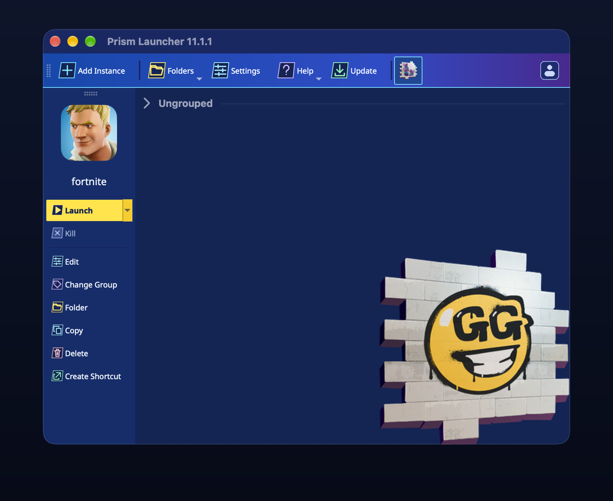

<!--
SPDX-FileCopyrightText: 2026 24by
SPDX-License-Identifier: CC0-1.0
-->

# chapter one lobby



### windows

[download the zip](https://github.com/24by/chapter-one-lobby-prism/archive/refs/heads/main.zip) and extract it. open the extracted folder in explorer, type `powershell` in the address bar, and press enter. paste this:

```powershell
powershell.exe -NoProfile -ExecutionPolicy Bypass -File .\install.ps1
```

for portable or scoop, open **folders → launcher root** in prism and pass that path:

```powershell
powershell.exe -NoProfile -ExecutionPolicy Bypass -File .\install.ps1 -PrismDir "D:\Prism Launcher"
```

### macos and linux

[download the zip](https://github.com/24by/chapter-one-lobby-prism/archive/refs/heads/main.zip) and extract it. open a terminal in the extracted folder and paste:

```sh
sh ./install.sh
```

for a custom prism folder, pass its path:

```sh
sh ./install.sh "/path/to/PrismLauncher"
```

restart prism and select **chapter one lobby** under **widgets** and **icons**.

by 24by · [cc0 1.0](LICENSES/CC0-1.0.txt)

<sub>preview shows a personal setup. the character icon and spray are separate from the download.</sub>

<sub>Portions of the materials used are trademarks and/or copyrighted works of Epic Games, Inc. All rights reserved by Epic. This material is not official and is not endorsed by Epic.</sub>
